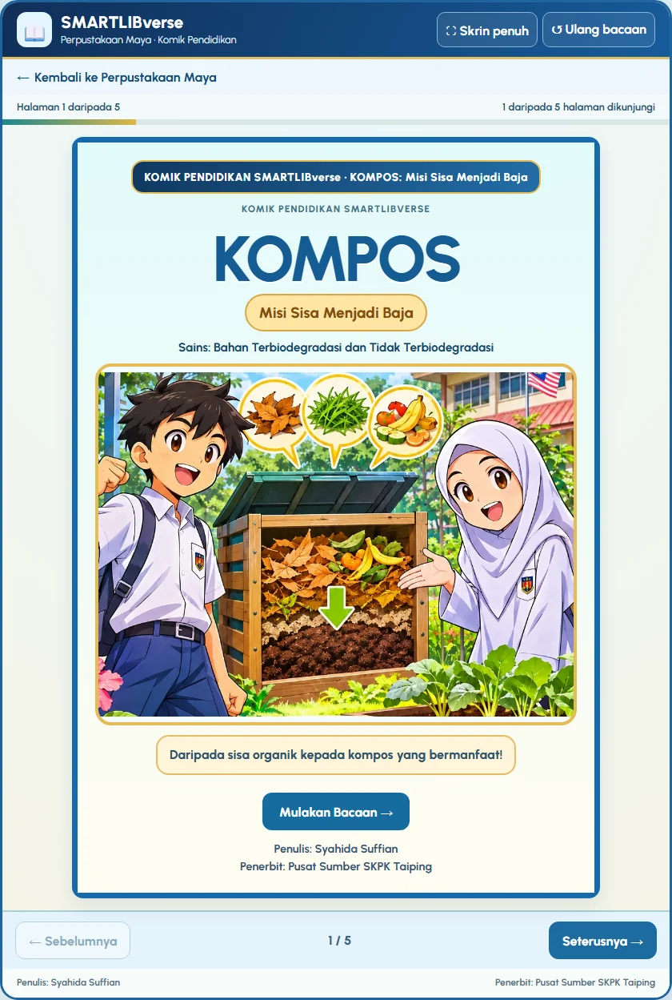
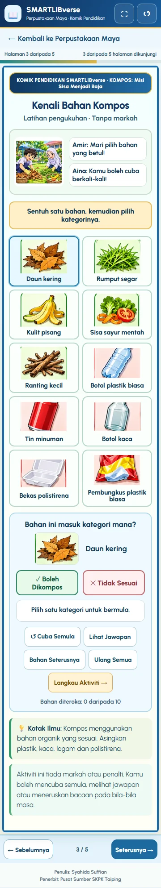

# KOMPOS v2 — integrasi Perpustakaan Maya

Sumber: `SMARTLIBverse_KOMPOS_Perpustakaan_Maya_Lengkap_v2.zip`.
SHA-256 ZIP: `38f009855ff3f75b9b20486859843cadba2c15b4be0d6b284dbb58db27e70b7b`.
Baseline produksi: `f3aed8b924e91b3cc2504fc8fc66c2f9521b9c8d`.

## Laluan dan skop

Perpustakaan Maya → **Sains & Alam** → **KOMPOS: Misi Sisa Menjadi Baja** → **Buka Komik KOMPOS**.

Modul statik berada di `books/kompos/`. Katalog menggunakan `new URL('./books/kompos/index.html', document.baseURI)`; halaman dunia sedia ada mempunyai `<base href="../">`, maka URL sebenar ialah `/smartlibverse/books/kompos/index.html`. Laluan direktori `/smartlibverse/books/kompos/` turut berfungsi. Butang kembali menggunakan `../../world/index.html?zone=library`.

Ini ialah pelepasan pakej KOMPOS v2 berasingan yang diminta pengguna. Integrasi koleksi universal/enam buku berada pada branch/worktree berasingan dan tidak disertakan. Tiada template yang belum dibekalkan dilabel sebagai sumber enjin ini.

Hanya kad katalog rak Sains & Alam ditambah dalam `js/main.mjs`. Tiga cerita/kuiz asal dan buku Roket kekal. Tiada pautan tambahan dalam modul lain, ganjaran XP atau rekod NILAM rasmi. `world/index.html` hanya menukar nilai versi query skrip supaya kad baharu tidak tersangkut dalam cache lama. Workflow GitHub sedia ada dikekalkan.

## Kandungan dan aset

- Lima halaman: Kulit Depan, Apa Itu Kompos?, Kenali Bahan Kompos, Jom Buat Kompos!, Rumusan dan Pengajaran.
- Semua prosa, dialog, fakta, kategori dan jawapan daripada pakej dikekalkan. Teks HTML/label/maklum balas boleh disunting dalam `book-data.js`; tiada mod penyuntingan grafik atau dakwaan bahawa teks raster boleh disunting.
- 23 WebP dibekalkan kekal byte-identical, jumlah kira-kira 1.20 MB. Tiada imej baharu dijana, dicrop atau diwarnakan semula. Manifest merekod dimensi, saiz dan checksum setiap aset.
- Potongan `pengenalan-bekas.webp` dan `mikroorganisma.webp` mempunyai cebisan dialog/label raster. Dua panel pengenalan menggunakan ilustrasi bersih sedia ada `proses-1-bahan.webp` dan `keratan-kompos.webp`, dengan teks alternatif yang sepadan. Dialog dan fakta tetap sama. Potongan asal dikekalkan untuk audit tetapi tidak digunakan dalam pembaca.
- Imej halaman penuh `assets/pages`, `assets/reference`, PNG pendua dan pratonton pakej kekal dalam arkib sumber di luar binaan awam. Antara muka sebenar menggunakan ilustrasi/bahan berasingan dan teks DOM.
- Urbanist dimuat sekali melalui Google Fonts `display=swap`, dengan fallback Arial/sans-serif. Tiada fail fon diedarkan.
- Panel tinggi semula jadi dan `object-fit: contain` memastikan seluruh ilustrasi dan teks boleh dibaca dengan tatal menegak, termasuk pada telefon dan fullscreen. Tiada ruang panel tersembunyi yang mesti diteka untuk menatal.

## Aktiviti tanpa markah dan penyimpanan

Sepuluh bahan mempunyai kedua-dua kategori **Boleh Dikompos / Tidak Sesuai**. Jawapan salah boleh dicuba semula tanpa had. Lihat Jawapan, Cuba Semula, Bahan Seterusnya, Ulang Semua dan Langkau Aktiviti ialah butang sebenar. Butang bahan dikekalkan dalam DOM ketika maklum balas berubah supaya fokus papan kekunci tidak hilang.

Langkau Aktiviti terus membuka halaman 4 sebelum menjawab sebarang soalan. Lawatan kepada lima halaman sahaja menentukan mesej tamat bacaan. Ulang Semua mengosongkan penerokaan bahan tanpa mengubah kemajuan bacaan.

Kemajuan buku menggunakan `smartlibverse_kompos_read_v1` dalam localStorage, serasi dengan kunci pakej sumber. Refleksi pilihan maksimum 2000 aksara hanya menggunakan sessionStorage `smartlibverse_kompos_reflection_v1`. Tab baharu mempunyai refleksi kosong; tiada refleksi disimpan dalam localStorage atau dihantar ke pelayan. Reset bacaan hanya menjejaskan rekod lawatan buku ini. Pembaca tidak mengakses kunci kemajuan permainan.

Hash URL `#page=N`, butang Sebelumnya/Seterusnya, anak panah/PageUp/PageDown, swipe mendatar, pembatalan sentuhan, fullscreen asli/fallback dan reduced motion disokong. Jika storage tidak tersedia, mesej menerangkan bahawa bacaan masih boleh diteruskan dalam sesi.

## Pengesahan

- `npm test`: 32 ujian unit lulus, termasuk kandungan asal, kategori bahan, integriti 23 aset, laluan GitHub Pages, label daripada data dan pengasingan storage.
- `npm run build`: binaan statik, semakan sintaks/rahsia awam, hash aset HD-2D/Roket/KOMPOS dan pengecualian aset rujukan lulus.
- Ujian pembaca Chromium pada 360 × 800, 390 × 844, 820 × 980 dan 1366 × 768 lulus. Semua lima halaman dan imej dimuat; kedua-dua kategori bagi sepuluh bahan diuji, termasuk jawapan salah berulang, jawapan betul, Lihat Jawapan, reset dan fokus papan kekunci.
- Tamat bacaan selepas melangkau aktiviti, swipe/pembatalan, fullscreen asli/fallback, font fallback, kegagalan storage, refleksi sesi/tab baharu, lawatan tersimpan dan pautan kembali turut diuji. Tiada horizontal overflow, panel terpotong, 404 aset atau uncaught JavaScript error dalam konteks ujian tersebut.
- Suite regresi penuh lulus pada 1366 × 768, 820 × 980 dan 390 × 844, ditambah ujian pembaca pada 360 × 800. Ini meliputi akses sebenar melalui rak perpustakaan serta permainan, Roket, cerita/kuiz, ganjaran idempotent, avatar, portal, sijil dan syarat Zon Rahsia, tanpa ralat halaman atau aset hilang.
- Initializer data sintetik ujian diperbetulkan supaya tab baharu tidak memasukkan semula profil permainan ke localStorage yang dikongsi. Semakan pengasingan storage kekal ketat: semua kunci permainan/buku lain dibandingkan sebelum dan selepas pembacaan; hanya kunci bacaan KOMPOS boleh berubah. Kod penyimpanan permainan produksi tidak diubah.
- CI dan pengesahan produksi perlu lulus sebelum pelepasan dilaporkan berjaya; hasil sebenar direkod pada PR pelepasan.

Semua ujian menggunakan konteks pelayar sintetik berasingan. Ini ujian Chromium viewport/touch, bukan ujian fizikal Android/iPad atau pembaca skrin khusus. Screenshot setiap halaman dimuat naik oleh workflow sedia ada.

Tiada perubahan pada repo SMARTLIB utama, login/autentikasi, backend, Apps Script, Google Sheets, OPAC, sirkulasi atau data pelajar.
