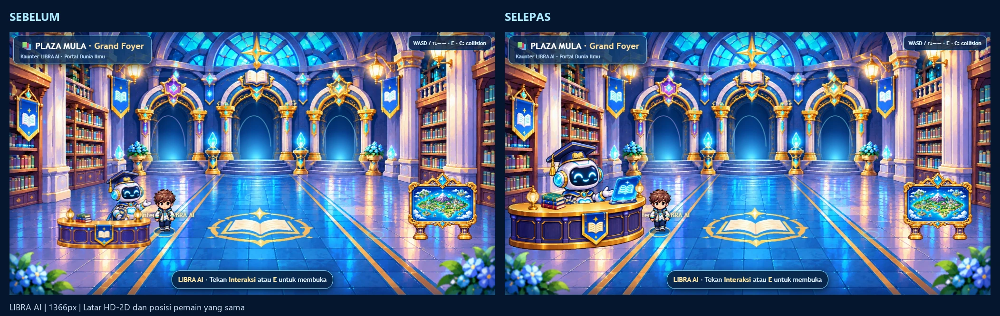
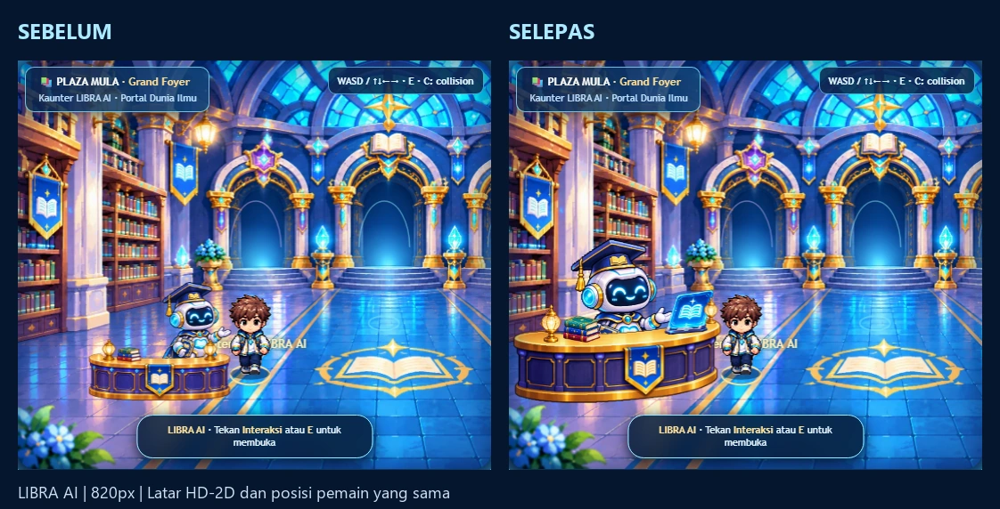
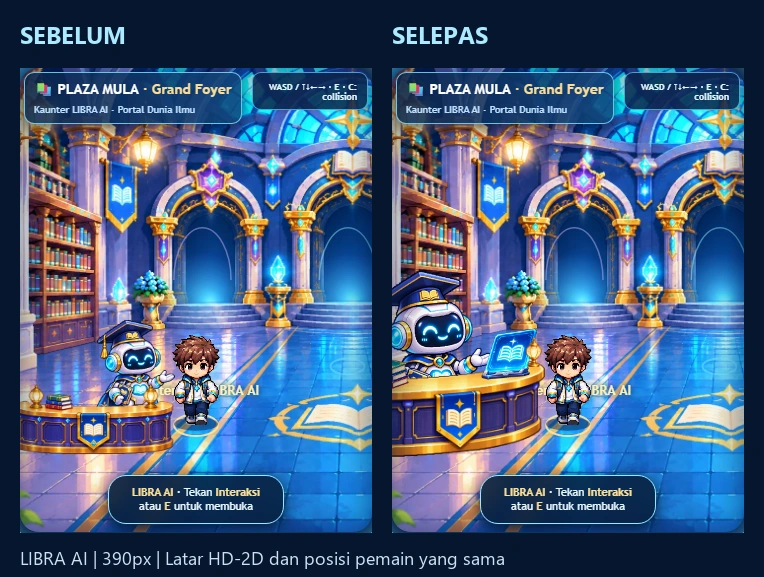

# LIBRA AI reception restoration review

Baseline: `b44425acb27e981d6e244b976d246cab84b29653` (main).
Branch: `feature/restore-libra-reception`.
This correction requires explicit user approval before merge or Pages publication.

## Visual change

The reception group restores the original composition shown in the approved foyer artwork: a broad curved navy/gold counter, hanging open-book pennant, angled blue tablet, small gold lamps and books. The unchanged original `libra_ai.png` is larger and sits behind the left side of the counter. Its face, graduation cap and welcoming gesture remain visible; the foreground counter hides the lower body.

The four new transparent WebP props are reference-guided reconstructions rather than a pixel-identical extraction from the old flattened scene. Their prompts, source hashes and mechanical alpha-padding/size preparation are recorded in [reception-restoration-assets.json](reception-restoration-assets.json). They were prepared using the built-in image generator. No old scenery fragments were composited into the new background. The old replacement asset is retained for rollback/comparison but is no longer rendered.

## Independent layers and preserved behavior

`js/plaza-layers.mjs` draws the original robot first, the restored desk in front, then individual tabletop props. Both lamps share one decoded image. All coordinates use the existing 1672 × 941 world transform, so the camera scales the composition together on phones, tablets and desktops. Reception retains its existing depth-sort boundary.

The HD-2D Plaza background, World Map, portal effects, `index.html`, hotspots, collision polygons, avatar controls/sprites, save schema, localStorage keys, XP/rewards, learning worlds, missions and other zones remain unchanged. The `libra` hotspot still uses the same approach point (533, 724). No files in SKPKT/smartlib or its login/backend were accessed or changed for this correction.

## Before / after

These are actual Chromium screenshots using the same player position and reduced-motion setting. Left: current main. Right: restored branch. The baseline uses main's exact reception renderer and unchanged original assets against the same HD-2D scene.

## Validation

- `npm test`: 23 / 23 passed, including foreground occlusion, independent prop draws, shared image caching and failed-image fallback.
- `npm run build`: passed; public secret scan and hashes of all 20 HD-2D assets passed.
- Before/after visual captures: 1366 × 768, 820 × 980, 390 × 844; no horizontal overflow, failed local assets or uncaught JavaScript errors.
- Interactive browser preview: assisted navigation reached LIBRA and opened the original text/visual dialog; no console errors.
- `npm run test:browser`: passed locally at all three viewports with zero uncaught errors and no missing local assets. It covers original stories, quiz grading, idempotent rewards, secret lock, category interactions, save compatibility and all physical foyer hotspots. Added checks decode every new sprite and verify repeated LIBRA interaction does not award duplicate tutorial XP, with reception screenshots at all three viewports. The PR workflow independently repeats these checks.

Responsive tests use browser viewports. Physical Android/iPad hardware testing has not been performed. Phones retain the existing camera crop; LIBRA's face, tablet and the approach point remain visible at the reception stop. No collision or camera changes are introduced.

The production website remains on the existing main branch until the user approves this PR.
