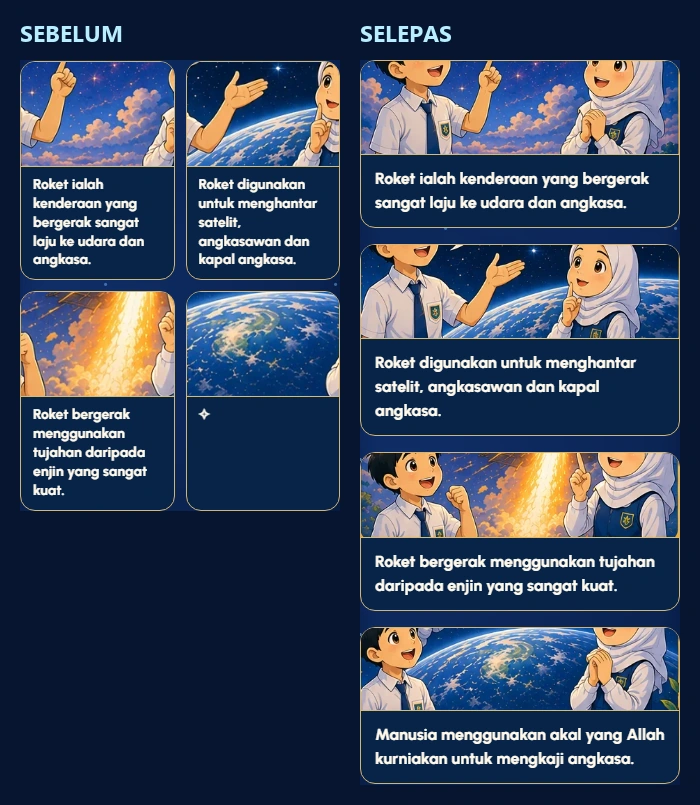
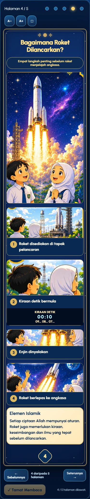
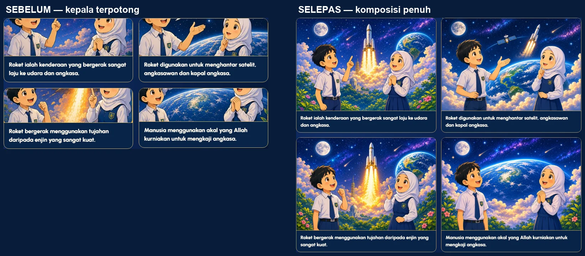
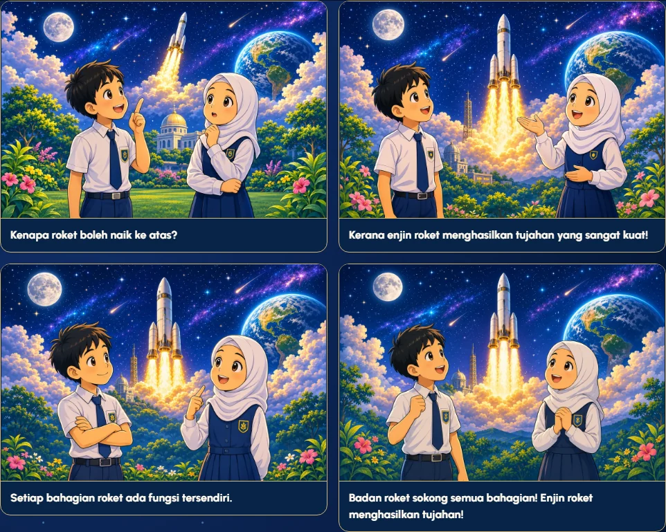

# ROKET editable flipbook integration

Source package: `SMARTLIBverse_Roket_Flipbook_Urbanist_EDITABLE_COMPLETE (1).zip`.
ZIP SHA-256: `8e111f80fbd34d584d701985ae8c3dc05ce088c371e899196dfaf440f095bc13`.
Baseline: `ebe2ca81918644ea0dc02567acccfb37fe248909`.
Branch: `feature/roket-editable-flipbook`.

## Entry point and preserved gameplay

Perpustakaan Maya → Sains & Alam → **ROKET: Keajaiban Ciptaan Allah di Angkasa** → **Buka Flipbook**.

`js/main.mjs` keeps the existing shelf book choices and adds one supplemental card only for `library` / `alam`. It uses `new URL('./books/roket-keajaiban/index.html', document.baseURI).href`. With the existing `<base href="../">`, the resulting route is `/smartlibverse/books/roket-keajaiban/index.html`. The directory route `/smartlibverse/books/roket-keajaiban/` also works on Pages. The reader returns via the supplied `../../world/index.html?zone=library` link.

The three original quiz books remain in `data/content.mjs`, unchanged. No XP, badge, quiz, mission, collision, avatar or game-state logic changes. Reading this supplemental flipbook does not award XP or create official NILAM records. The reader never accesses `smartlibverse_demo_v1`.

## Source integrity and editable copy

- Exactly five pages: cover, introduction, rocket parts, launch and benefits/conclusion.
- All 21 supplied WebP illustrations remain byte-identical in the source/build. Eight cropped conversation panels on pages 2 and 3 now display separately versioned, recomposed illustrations; the other twelve displayed illustrations retain their original assets. The extra engine illustration remains available as supplied.
- All original Malay data fields are unchanged. Two already visible section headings, **Mari Bercerita** and **Perbualan Sains**, were moved from fixed reader markup into new `conversationTitle` fields, so these headings are editable too. The formerly decorative fourth introduction panel now binds to `pages.1.conversations.3`, reusing the existing lesson sentence **Manusia menggunakan akal yang Allah kurniakan untuk mengkaji angkasa.**
- `books/roket-keajaiban/manifest.json` records source/current hashes and a canonical digest of the original content. Unit tests verify every original field, excluding only the additional editable headings and the fourth conversation added to fix the empty panel.
- The supplied edited page-4 reference, `04_pelancaran_TANPA_KHAT_ALLAH.png`, was visually inspected. Its audit hash is `ab796d586cee8de48b8d9db3c94f018756b3ce62b6a53ee82af91d192aa4b8aa`. The original obsolete page-4 asset is not used.
- `REFERENCE_ARTWORK`, original reference PNGs, package prompts and package preview files stay outside the repository and public build. No font files are bundled.

## Editing and local storage

Use **Edit teks** to edit text on the displayed page, then **Eksport JSON**. **Import JSON** restores compatible five-page text editions. **Teks asal** asks for confirmation before restoring the shipped text, without resetting game progress or the separate reading receipt.

Edits use `smartlibverse_roket_edits_urbanist_v1`; reading completion uses `smartlibverse_roket_read_v1`. Both are browser-local only. Exporting or importing never publishes to GitHub automatically. To publish an approved editorial revision, update `book-data.js` and intentionally update the manifest's text checksum/content baseline in the same reviewed change. Preserve original illustration hashes; record any user-authorized replacement art separately in the manifest.

Reader adjustments preserve the supplied art and editable copy, and add keyboard-accessible import, meaningful editor/fullscreen labels, larger page-selection targets, plain-text paste, safe text-only JSON rendering, import limits, touch cancellation, reliable horizontal gestures, reduced motion and explicit messages when browser storage/fullscreen is unavailable. Zoom now also applies to mobile body copy. Urbanist loads once from Google Fonts, with the supplied system-font fallback.

## Mobile panel correction

Pages 2–4 use a mobile-first single-column composition, automatic card heights and `object-fit: contain` for every illustration. Desktop/tablet columns return only when space permits. The rocket diagram is proportionally contained rather than stretched; the launch illustration and all comic/step images keep their complete source framing. Body copy stays at a readable size and cards grow for longer edited text or enlarged fonts. Pages 1 and 5 keep their existing layout.

All four introduction cards now come from the data array, with no decorative placeholder card. Existing three-entry browser saves/JSON editions retain their edits and receive the fourth default sentence. Blank imported text falls back to the corresponding shipped copy. A temporarily empty editor field is restored when returning to reading mode, with a visible message; nonblank edits remain intact. No game progress is reset.

## Character illustration correction — 22 November 2026

The desktop screenshots exposed a source-art problem: changing CSS to `contain` showed all the available pixels, but the original excerpts already cut off heads and faces. At the user's request, eight conversation scenes were recomposed with the built-in image generation tool, using each original excerpt and the supplied cover as pose/identity/style references. Both pupils' complete heads, faces, hijab and main gestures are visible with scenic space around them. These are newly generated compositions in the supplied cartoon style, not recovered original uncropped drawings.

- Eight sibling `art/*-v2.webp` files, each 1200 × 800 (3:2), replace only the runtime conversation images on pages 2 and 3. Original excerpts remain available and hash-checked.
- Proportional `contain` rendering, intrinsic dimensions and a reserved 3:2 ratio prevent new cropping and layout shift. The two pages can expand to 1040 px on desktop; mobile keeps natural-height stacked cards.
- No wording, editable fields, saved text, page count or game progress schema changes. Page 4 and its approved artwork remain byte-identical.
- Assets use WebP quality 86, 211–259 KB each, lazy loading and asynchronous decoding. No generated PNGs, reference sheets or font files are shipped.
- Source roles, exact prompts, processing and hashes are in [the artwork provenance](roket-character-art-prompts.json). The book manifest records all replacement paths and checksums.
- Visual review covers desktop at 1366 × 768 and 1920 × 1080, tablet at 820 × 980 and mobile at 390 × 844. These are Chromium viewport checks, not physical device tests. Inspecting screenshots verifies visible faces; automated aspect-ratio tests alone cannot verify character anatomy.
- Validation for this correction: 28 unit tests, the production build/public-secret scan, and the complete Chromium game/reader acceptance suite passed locally at 1366 × 768, 820 × 980 and 390 × 844 with no uncaught JavaScript errors. The suite verifies all eight replacement paths, decoded 1200 × 800 dimensions, full 3:2 rendering, responsive columns, editable copy/JSON round trips, unchanged page-4 art and preserved game progress. The existing PR and Pages workflows repeat these checks on GitHub and the deployed site.

## Previous layout validation and review evidence

- `npm test`: 27 unit tests passed.
- `npm run build`: static build, JavaScript syntax/public-secret scan, 20 existing HD-2D hashes, all 21 new illustrations, reader files and reference-art exclusion passed.
- `npm run test:browser`: Chromium acceptance at 1366 × 768, 820 × 980 and 390 × 844. This includes actual science-shelf navigation, five pages and image decoding, keyboard arrows/PageDown, numbered page controls, mobile CDP touch swipes/cancellation, edit persistence, JSON download/read-back/import, invalid/oversize import rejection, reset acceptance/cancellation, plain-text paste, fullscreen, zoom, reduced motion and the exact return route.
- Online Urbanist font faces were confirmed loaded. A separate context blocks Google Fonts to validate readable fallback.
- Existing stories, 4/5 quiz grading, reward idempotency, secret lock, avatars, physics, portals and extended saved progress remain covered by the original acceptance suite.
- Panel regression checks now inspect each card's scroll bounds, text bounds, nonempty text, image fit, mobile stacking and readable font sizes. They exercise the fourth editable panel, older three-entry JSON, blank-value fallback and long edited copy at 140% text size. The earlier page-only overflow check could not detect the original cropped images/placeholder card; these checks address that gap.
- Before/after game storage is compared byte-for-byte while inside the reader. On return to the library, profile, readings, quizzes, rewards and extension fields are compared again.
- Screenshots for all five pages at all three viewport sizes are uploaded by the unchanged Actions workflow. Current layout comparisons are in the mobile panel correction section above.

## Editorial and test limits

The original illustrations contain some cropped ornamental border fragments; page 4's unchanged `launch-hero.webp` has a small gold ornament at its upper edge, but no Arabic calligraphy is visible. Eight cropped character excerpts are superseded by the user-requested compositions described above; their originals remain unchanged. Original Malay wording and its scientific/religious framing have not been rewritten; the fourth introduction sentence is reused from the supplied lesson. School editorial review remains available through the text editor/export workflow.

Responsive visual review uses actual Chromium screenshots. The acceptance suite exercises real browser controls and touch events at the local URL and production URL. No physical Android/iPad or dedicated screen-reader hardware testing is claimed.

Only SKPKT/smartlibverse changes. SMARTLIB login, authentication, Apps Script, Google Sheets, other repositories and school databases are untouched.
